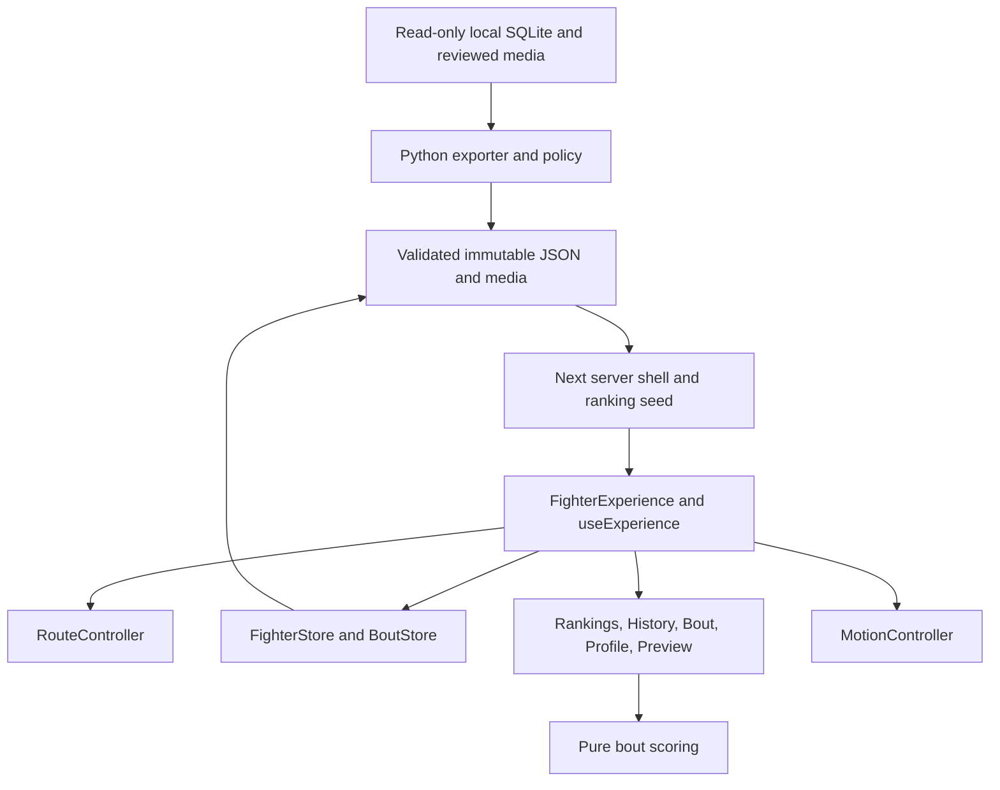

# 8. Components and module ownership

[Product Spec index](../product-spec.md) · Version 1.1 · Updated 2026-10-24.

The stack is Next.js App Router, React, TypeScript, Tailwind, GSAP, offline Python/SQLite export, and Vercel hosting.
Use Node.js 24 for CI and hosting. Exact package versions come from the lockfile.
Do not add an online database or browser source crawler to implement these functions.

| Owner                              | Responsibility                                                                                  | Boundary                                                                                            |
| ---------------------------------- | ----------------------------------------------------------------------------------------------- | --------------------------------------------------------------------------------------------------- |
| Rankings page and server reader    | Parse initial request; validate pinned release; render shell and ranking summaries              | Do not ship the entire fighter archive or statistics population in initial payload.                 |
| FighterExperience                  | Compose persistent layout, preview interaction, route controls, focus, and dataset-stable mount | Do not create independent view-specific routers.                                                    |
| useExperience                      | Reducer, committed state, generations, preparation, cancellation, and atomic view commit        | DOM animation stays in the motion owner.                                                            |
| RouteController                    | Parse/traverse/commit routes and owned browser entries                                          | Preserve framework state and native external navigation.                                            |
| FighterStore                       | Validate/load fighter bundles, archive index, and media from the pinned version                 | Full History must not use the three-record home seed as a complete cache. Current bundle bound: 32. |
| BoutStore                          | Load validated bout/reference pairs and check participant/period                                | Current pair cache bound: 16. Do not cache partial or aborted loads.                                |
| CategoryDropdown / CategoryHeading | Published menu, accessible keyboard behavior, current division identity                         | Registry-driven, no fixed division pair.                                                            |
| RankingDial                        | Circular geometry, input intent, looping, and row-position tween                                | Separate inner dial transforms from outer category drawers.                                         |
| FighterFigure / FighterImage       | Reviewed role selection, rendering, fallback, and rankings return                               | No independent portrait-container entrance opacity.                                                 |
| FighterProfile                     | Career facts, finish bars, recent results, source and history/bout entry                        | Never derive career totals from the recorded list.                                                  |
| FightHistory                       | Full rows, internal scrolling, preview triggers, opponent/event/result actions                  | Restore list before reverse title measurement.                                                      |
| OpponentPreview                    | Nonmodal placement, own request cancellation, close/focus behavior                              | No route change until an action is activated.                                                       |
| BoutAnalysis                       | Participant and period controls, summary, SVG radar, inspection, disclosure, sticky return      | Current subparts live in `bout.tsx`; do not assume separate files exist.                            |
| Pure domain scoring                | Formula, normalization, null semantics, weighted contributions                                  | No fetches, browser state, or presentation ownership.                                               |
| MotionController / text helpers    | Measured live-node transitions, interruption cleanup, viewport stability                        | Keep one property owner and stable final glyph identity.                                            |
| Offline exporter / validators      | Read-only source extraction, reference generation, artifact integrity                           | No source database writes during web work.                                                          |
