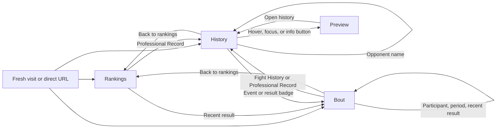

# 3. User journeys

[Product Spec index](../product-spec.md) · Version 1.3 · Updated 2026-10-24.

These journeys cover the current interface, including normal paths and recovery branches.
They do not imply that every input, device, and data combination has a separate automated test.

Bout entry requires the pinned dataset's analysis capability.
Older datasets retain rankings and history. Event text has no internal bout action; result and recent-form links use available source URLs.

### J01 — Start or restore rankings

Entry: Open `/`, `/rankings`, or a rankings URL.

1. Resolve the published division from the URL. Use Featherweight if it is absent or invalid.
2. Resolve the selected fighter within that ranking. Use its champion if selection is absent or invalid.
3. Show the matching selector row, portrait, profile, and snapshot date.
4. Refresh an explicit selection URL to retain that division and fighter.

Result: The page shows one consistent ranking selection. Unranked fighters are accessible through History, not home selection.
Evidence: `foundation.spec.ts`, `all-divisions.spec.ts`, and `routes.test.ts`.

### J02 — Change division

Entry: Open Weight Division in Rankings.

1. Choose one of the 11 published divisions in registry order.
2. Prepare the target data and champion image while retaining the current view.
3. Run the coordinated heading, selector, portrait, and profile transition.
4. Select the target champion and update the URL.

The menu supports pointer selection, Arrow keys, Home, End, Enter, and Space.
Escape, Tab, and an outside pointer action dismiss the menu. Escape restores trigger focus.
The menu scrolls on narrow screens. Another category change is disabled during preparation and motion.
Failure retains the current division and offers Retry. See J14.
Evidence: `selector.spec.ts`, `all-divisions.spec.ts`, `foundation.spec.ts`, and `motion.spec.ts`.

### J03 — Explore ranked fighters

Entry: Use the circular selector in Rankings.

1. Select a row, scroll the wheel, drag, or use the up/down buttons.
2. With selector focus, use Arrow keys to move and Home/End to reach the endpoints.
3. Crossing either sequence boundary loops through the list.
4. Commit the matching portrait, profile, and explicit selection URL together.

Result: Selection changes within the same division. Selecting a fighter does not open History.
A newer selection supersedes obsolete preparation. Missing images use reviewed fallbacks. See J14 and J15.
Evidence: `foundation.spec.ts` and `all-divisions.spec.ts`.

### J04 — Open and read fighter history

Entry: Activate Professional Record in Rankings or open a direct History URL.

1. Load the selected fighter's complete exported record list.
2. Move the figure to the left and show History in the middle.
3. Read result, opponent, event, location, date, method, ending round, and time.
4. Scroll inside the card to reach older records.

Result: The count equals the exported records, not the career-record total.
An empty archive shows its empty state. Missing facts remain unavailable. See J15.
Evidence: `history.spec.ts` and `routes.test.ts`.

### J05 — Preview an opponent

Entry: Hover or focus an opponent name in History, or activate its information button.

1. Show a nonmodal brief profile inside the viewport.
2. Keep it open while pointer or focus moves into the card.
3. Read the available portrait, career record, age, height, and reach.
4. Close it by leaving both trigger and card, using its close control, an outside action, or Escape.

Preview does not change the URL or reset the history list.
Touch uses the information button. Escape closes Preview before leaving History.
A late response must not reopen a closed preview. Failed preview loading must not navigate away.
Evidence: `history.spec.ts`.

### J06 — Follow an opponent into the archive

Entry: Activate an opponent-name link or the preview's history action.

1. Prepare that fighter by stable ID, including unranked fighters in the source archive.
2. Keep the active rankings division as navigation context.
3. Replace the current History entry and reset the new fighter's list position.
4. Update the figure, history, and profile together.

Result: Repeated opponent visits do not create a long browser Back chain.
Modified link clicks retain native browser behavior. Unknown IDs show an error; they do not silently select another fighter.
Evidence: `history.spec.ts`, `motion.spec.ts`, and `routes.test.ts`.

### J07 — Return to rankings

Entry: Use Back to rankings in History or Bout; use Professional Record to close History; use Escape in History with no preview open.

1. Cancel pending requests and active motion.
2. Return through the owned home entry.
3. Select the current fighter if ranked in the active division; otherwise select that division's champion.

Native Back from History follows the same selection rule.
Back to rankings from Bout skips its parent History entry. Native Back from Bout first returns to History instead.
The next Back from the owned home entry can leave the website.
Evidence: `history.spec.ts`, `bout.spec.ts`, and `routes.test.ts`.

### J08 — Open bout analysis from history

Entry: Activate an event name or its result badge in History.

1. Load the bout, its two participants, and the historical scoring reference.
2. Open the All period with the same selected fighter and active division context.
3. Enlarge the portrait and move the event title into the large bout heading.
4. Fade the other content into its final layout.

The history title and bout heading use the same display font and uppercase treatment.
Final live title glyphs move throughout the transition. The portrait container stays visible.
A failed request keeps the previous view and offers recovery. See J14.
Evidence: `bout.spec.ts` and `bout-motion.spec.ts`.

### J09 — Open a recent result

Entry: Activate a Recent Form entry in the profile from Rankings, History, or Bout.

1. Open that result's bout for the current fighter in the All period.
2. From Rankings, create a fighter-history parent before opening the bout.
3. From History, push one bout entry. From Bout, replace the current bout entry.

Result: Fight History has a consistent destination regardless of the entry point.
Modified clicks retain usable URLs. Older datasets without analysis keep the source-link fallback.
Evidence: `bout-motion.spec.ts` and `routes.test.ts`.

### J10 — Compare participants and periods

Entry: Use either participant control or All/Round controls in Bout.

1. Selecting a participant updates the selected portrait and profile. Keep the same bout and period.
2. Selecting a period updates summary statistics, radar, and score breakdown together.
3. Replace the current bout URL entry. Refresh restores that participant and period.

Result: No extra browser-history entry is created for each control change.
Series colors remain stable. Profile facts use their profile snapshot, not the historical fight date.
Only actual periods are offered. Rapid changes settle on the newest valid target.
Evidence: `bout.spec.ts` and `routes.test.ts`.

### J11 — Inspect radar scores

Entry: Hover a radar line or point in Bout.

1. Highlight its fighter series.
2. Show the fighter and all axis totals, or the selected axis and its total.
3. Show component values on separate rows for point inspection.
4. Leave the chart to clear the hover state.

Click and tap do not pin or select radar values. Geometry has no keyboard activation.
Use J12 for keyboard and touch access to the full values.
Scores describe this period's statistics. Tank measures impacts received, not defensive ability.
Evidence: `bout.spec.ts` and `bout-motion.spec.ts`.

### J12 — Read formulas and complete breakdowns

Entry: Expand How to read this chart with pointer, keyboard, or touch.

1. Read the formula, reference window, population, period, and limitations.
2. Read all five axes for both fighters, independent of hover.
3. Inspect raw values, normalized values, weights, and weighted contributions.
4. Collapse the disclosure when finished.

The disclosure starts closed. An unavailable score does not hide available raw evidence.
Insufficient historical samples and periods below 60 seconds have explicit notices.
Evidence: `bout.spec.ts`. Formula details: section 7 of this spec.

### J13 — Return from bout to history without a page jump

Entry: Use the sticky Fight History button, Professional Record in Bout, Escape, or native Back.

1. Return to the currently selected participant's History in the same division context.
2. Restore the saved list position for that fighter and originating bout.
3. If no saved position exists, reveal the matching row.
4. Shrink the portrait and move the event title back into the row; fade the other content.
5. Retain the current document scroll position throughout the transition and cleanup.

Document scrolling and list scrolling are independent.
The shorter History view retains enough document space to prevent the browser from clamping the current position.
The return control stays at the card top while bout content scrolls and remains visible during page scrolling through the card.
Reduced-motion mode keeps the same route and scroll outcome without a spatial flight.
Evidence: `bout-motion.spec.ts`, `bout.spec.ts`, and [scroll validation](../evidence/m6-scroll-validation.json).

### J14 — Recover from unavailable or interrupted navigation

Entry: A fighter or bout request is slow, fails, has invalid identity data, or is superseded.

1. Retain committed content while preparing a new target.
2. Cancel obsolete preparation and ignore stale responses.
3. For a recoverable request failure, show an error and Retry.
4. Retry the requested target, return to History when offered, or return to rankings.

Unknown fighter IDs have a return action rather than an invented fighter.
Invalid bout IDs, nonparticipants, malformed periods, and unavailable rounds show an explicit bout error.
Returning or pressing Escape cancels pending work. Resize and reduced-motion changes settle temporary motion styles.
These error states differ from a successfully loaded bout with unavailable scores; see J15.
Evidence: `foundation.spec.ts`, `history.spec.ts`, `bout.spec.ts`, and `motion.spec.ts`.

### J15 — Read incomplete records and unavailable scores

Entry: Open a fighter or bout with missing media, facts, history, statistics, or reference coverage.

| Condition                                       | Visible result                                                             |
| ----------------------------------------------- | -------------------------------------------------------------------------- |
| No recorded bouts                               | Empty history; no fabricated recent results.                               |
| Missing profile fact                            | Em dash; career totals are not inferred from the fight list.               |
| Missing or failed portrait                      | Reviewed headshot fallback, then initials.                                 |
| Missing statistic or elapsed duration           | Unavailable score and available raw values; null is not converted to zero. |
| Fewer than 50 eligible historical bouts         | Unavailable scores; no borrowed division or widened window.                |
| Nonpositive normalization bound after fallbacks | The affected score is unavailable.                                         |
| Any required radar axis unavailable             | No misleading complete radar; explain the limitation.                      |
| Period below 60 seconds                         | Short-sample notice.                                                       |

Evidence: `history.spec.ts`, `bout.spec.ts`, `bout-scoring.test.ts`, and the [data report](../m6-data-report.md).

### J16 — Share, refresh, and traverse a view

Entry: Open a copied URL, refresh, or use browser Back/Forward.

| View     | URL parameters                                      | Restored state                                      |
| -------- | --------------------------------------------------- | --------------------------------------------------- |
| Rankings | `division`, `selected`                              | Division and a valid ranked selection.              |
| History  | `division`, `fighter`, `view=history`               | Fighter archive in the requested division context.  |
| Bout     | `division`, `fighter`, `view=bout`, `bout`, `round` | Participant, bout, and All or a valid actual round. |

Direct History entry creates an owned home parent. Direct Bout entry creates home, History, and Bout once.
Reload reuses those entries. Opponent, period, and participant changes replace the relevant entry.
Forward from returned History restores the latest bout state. Back can then return to the current participant's History.
Preview, hover, disclosure state, and internal scroll positions are not encoded in shareable URLs.
Do not intercept navigation outside the application-owned route.
Evidence: `history.spec.ts`, `bout.spec.ts`, `bout-motion.spec.ts`, and `routes.test.ts`.

### J17 — Read sources

Entry: Use Official Fighter Profile, Fighter Statistics, or Bout Data source links.

Open the recorded source URL in a new tab where the control specifies it.
Keep the active application context available in the original tab.
History event and result links open internal analysis only when the dataset supports it.
Recent Form uses its source link when analysis is unavailable.
Source visits do not update the local data snapshot.
Implementation references: `profile.tsx`, `history.tsx`, and `bout.tsx`.
A source-link inventory is not a test of external website availability.
